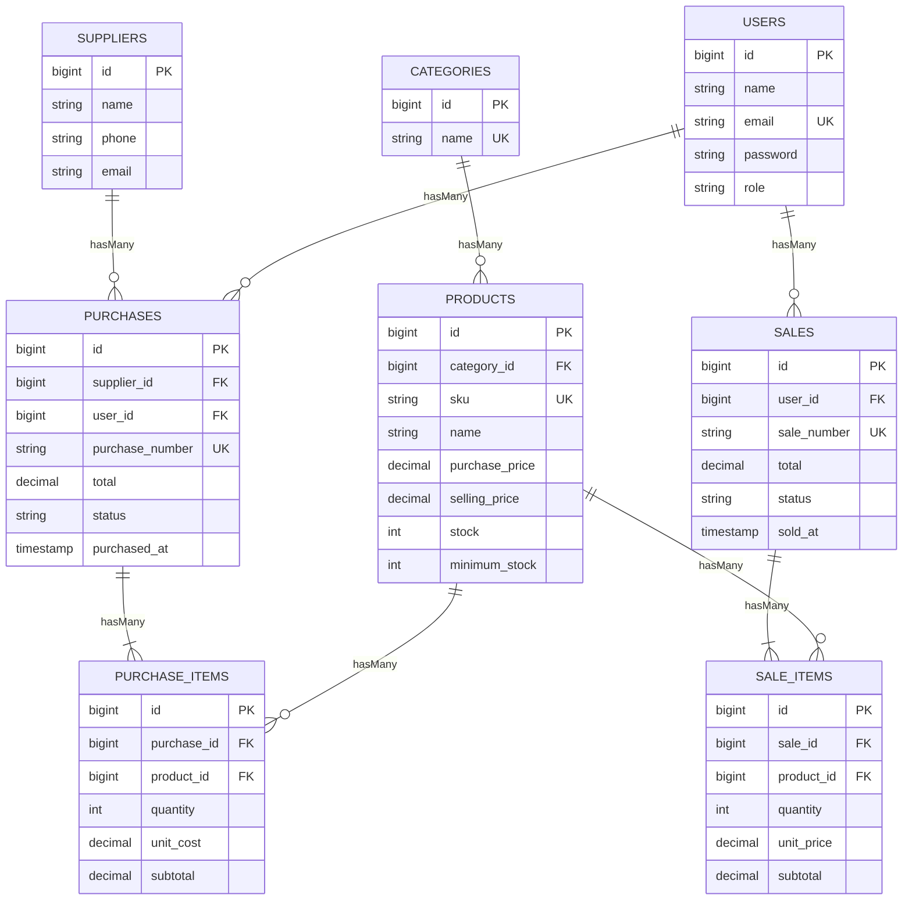

# Mini Market - Inventory & Sales Management System

Aplikasi web terintegrasi untuk UTS Web Programming 2 (Laravel 10, MySQL, Eloquent ORM).
Mengelola master data (kategori, produk, supplier), transaksi pembelian (stock-in) dan penjualan,
dengan stok yang berubah otomatis dan konsisten.

## Requirements
- PHP 8.1 atau lebih baru (ekstensi: pdo_mysql, mbstring, openssl)
- Composer
- MySQL / MariaDB (misalnya lewat XAMPP)

## Installation
```
git clone <repository-url>
cd inventory-sales-uts
composer install
cp .env.example .env
php artisan key:generate
```
Di Windows PowerShell, `cp` berfungsi sama dengan `copy`.

## Environment setup
Buka file `.env`, lalu sesuaikan koneksi database:
```
DB_CONNECTION=mysql
DB_HOST=127.0.0.1
DB_PORT=3306
DB_DATABASE=inventory_sales
DB_USERNAME=root
DB_PASSWORD=
```
Nyalakan MySQL. Jika database belum ada, `php artisan migrate` akan menawarkan untuk membuatnya (jawab `yes`).

## Migration & seeding
```
php artisan migrate --seed
php artisan serve
```
Buka http://127.0.0.1:8000

## Demo account
| Role  | Email             | Password |
|-------|-------------------|----------|
| Admin | admin@example.com | password |
| Staff | staff@example.com | password |
| Pembeli | pembeli@example.com | password |

Akun ini hanya untuk demo (data dummy).

## Features
- Login/logout, password hashing, protected routes
- Role-based access (Admin dan Staff), dicek di server lewat middleware `AdminOnly`
- CRUD Kategori, Produk, Supplier dengan validasi server-side
- Pembelian (stock-in) dan Penjualan dengan banyak item per transaksi
- Stok bertambah/berkurang otomatis dalam satu `DB::transaction`
- Penjualan ditolak jika stok tidak cukup (tanpa mengubah data)
- Total transaksi dan harga jual dihitung server dari database
- Pembatalan transaksi (Admin) yang memulihkan stok secara konsisten
- Produk yang sudah dipakai transaksi tidak dapat dihapus
- Pencarian (SKU/nama), filter kategori, filter tanggal dan status, pagination
- Dashboard dari query agregat dan daftar stok rendah

## Business rules
- SKU unik (validasi Laravel + unique index database)
- Kuantitas transaksi minimal 1, harga tidak boleh negatif
- Penjualan tidak boleh melebihi stok; `lockForUpdate()` mencegah overselling pada transaksi bersamaan
- Stok hanya berubah lewat transaksi (tidak bisa diedit manual dari form produk)
- Pembatalan pembelian ditolak jika stok hasil pembelian itu sudah terpakai

## ERD


Foreign key berada di tabel detail ("many") karena satu baris induk dirujuk banyak baris detail,
sehingga `hasMany()` ada di induk dan `belongsTo()` ada di detail.

## Testing
Tes memakai database SQLite di memori, sehingga data MySQL tidak tersentuh.
```
php artisan test
```
Skenario: guest ditolak, password salah, SKU duplikat, harga negatif, pembelian menambah stok,
penjualan mengurangi stok, stok tidak cukup, rollback atomik, pembatalan memulihkan stok,
otorisasi staff, pencarian, filter stok rendah, dan pagination.

## Screenshots
Letakkan di folder `docs/screenshots`: login, dashboard, daftar produk, form penjualan, detail transaksi.

## Known limitations
- Manajemen pengguna hanya menampilkan daftar (akun dibuat lewat seeder)
- Transaksi yang sudah selesai tidak dapat diedit, hanya dibatalkan
- Belum ada laporan ekspor (PDF/Excel) dan payment gateway


## Alur pesanan (pembeli, staff, admin)
- Pembeli: pilih produk, masukkan ke keranjang, lalu Checkout. Pesanan berstatus "Menunggu" dan stok belum berubah.
- Staff: menerima atau menolak pesanan. Saat diterima, dalam satu `DB::transaction` dibuat transaksi penjualan dan stok dikurangi (ditolak jika stok tidak cukup).
- Admin: hanya melihat data pesanan dan penjualan (read-only), serta mengelola data master dan pengguna.
- Harga dan total selalu dihitung server dari database.

