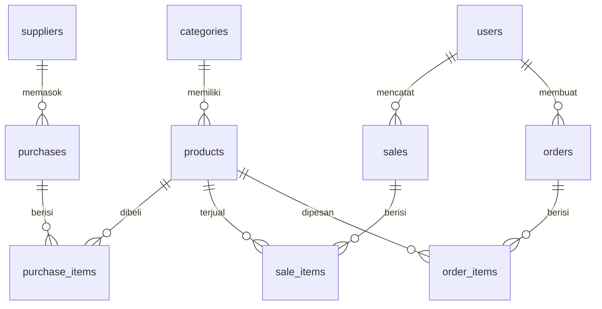

# Saimah Mart - Inventory & Sales Management System

Aplikasi web untuk mengelola stok barang, pembelian dari supplier, penjualan, dan pesanan pelanggan. Dibuat untuk UTS Web Programming 2 menggunakan **Laravel 10**, **MySQL**, dan **Eloquent ORM**.

## Fitur

- **Dashboard**: ringkasan data toko
- **Produk**: tambah, ubah, hapus produk (dengan gambar)
- **Stok Rendah**: daftar produk yang stoknya hampir habis
- **Kategori** dan **Supplier**: kelola data master
- **Pembelian**: barang masuk dari supplier (stok bertambah otomatis)
- **Penjualan**: transaksi penjualan dengan metode pembayaran (stok berkurang otomatis)
- **Pesanan**: pesanan dari pembeli lewat keranjang
- **Pengguna**: kelola akun dan role, dengan pencarian dan filter role
- **Login** berbasis role

## Role Pengguna

| Role | Keterangan |
|---|---|
| admin | Akses penuh, termasuk kelola pengguna |
| staff | Mengelola operasional toko |
| pembeli | Melihat produk dan membuat pesanan |

## Requirements

- PHP 8.1 atau lebih baru (ekstensi: pdo_mysql, mbstring, openssl)
- Composer
- MySQL / MariaDB (misalnya lewat XAMPP)

## Instalasi

```bash
git clone <repository-url>
cd inventory-sales-uts
composer install
cp .env.example .env
php artisan key:generate
```

Buat database `inventory_sales` di phpMyAdmin, lalu atur `.env`:

```env
DB_CONNECTION=mysql
DB_HOST=127.0.0.1
DB_PORT=3306
DB_DATABASE=inventory_sales
DB_USERNAME=root
DB_PASSWORD=
```

Jalankan migrasi dan server:

```bash
php artisan migrate --seed
php artisan serve
```

Buka `http://127.0.0.1:8000`

## Akun Demo

| Role | Email | Password |
|---|---|---|
| Admin | admin@example.com | admin123 |
| Staff | staff@example.com | staff123 |
| Pembeli | saimah@gmail.com | 123456789 |

## ERD

